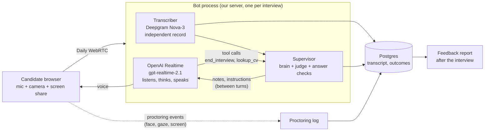

# Realtime Architecture

> **Status: step 1 built, not deployed.** Branch `realtime-poc`, cut from
> `main` at `3aa8dac` on 2026-11-13. Off by default: nothing changes unless
> `INTERVIEW_ENGINE=realtime` is set. [TECH_SPEC.md](TECH_SPEC.md) still
> describes the production system. Start with section 0; the rest is the
> design and the plan.

## 0. Handover: what changed from `main`

### In one sentence

The bot now has a second voice engine. Today's engine passes each turn through
three services (Deepgram, then GPT-4.1-mini, then ElevenLabs). The new one uses
a single OpenAI Realtime model that hears the candidate and speaks back
directly, which is what made the Burj Khalifa kiosk feel smooth. One setting
chooses between them; the old engine is untouched and remains the default.

### Before and after

```
main (INTERVIEW_ENGINE=pipeline, the default)

  Daily in -> Silero VAD + smart-turn -> Deepgram STT -> BrainDirector -> GPT-4.1-mini -> ElevenLabs -> Daily out
              (when did they finish?)    (words)        (brain plans     (what to say)    (voice)
                                                         every turn)

realtime-poc (INTERVIEW_ENGINE=realtime)

  Daily in -> Silero VAD (measures only) -> OpenAI Realtime gpt-realtime-2.1 -> Daily out
                                            (decides when they finished, what to say, says it)
                                                   ^
                                    RealtimeCoordinator: clock notes, ending tools, hang-up
```

Everything outside the bot process is identical: admin panel, clarification
chat, blueprint generation, Daily rooms and credentials, join page, consent,
database, feedback scoring, deployment, capacity cap.

### What each engine does, piece by piece

| Job | `pipeline` engine (main) | `realtime` engine (this branch) |
| --- | --- | --- |
| Deciding the candidate has finished | Silero VAD + smart-turn v3, ours (`turn_taking.py`) | OpenAI `semantic_vad`, eagerness `low` |
| Turning speech into words | Deepgram Nova-3 | Inside the model; the transcript comes from OpenAI's `gpt-realtime-whisper` |
| Deciding what to say | `gpt-4.1-mini`, context rebuilt by the brain every turn | `gpt-realtime-2.1`, whole interview plan in one opening prompt |
| Voice | ElevenLabs (our voice ID) | OpenAI built-in voice `cedar` |
| Keeping time and moving between areas | The brain, before every reply | `RealtimeCoordinator` inserts a note at each section boundary |
| Candidate asks to stop | `end_interview` tool + pattern check | Same tool, same pattern check, now in the coordinator |
| Natural end of interview | Brain detects the goodbye | Model calls a new `finish_interview` tool with its goodbye |
| Hanging up after the goodbye | `SessionEnder` observer | `RealtimeCoordinator` observer |
| Silence prompts | Spoken through ElevenLabs | Same ladder, spoken through the Realtime model |
| Contradictions, coverage, refusal counting | Brain + judge | **Not yet.** Step 3 (section 8) |
| Cost tracking | None | Token usage and estimated USD per interview, saved to the session |

### New files (all on this branch only)

| File | Lines | What it does |
| --- | --- | --- |
| `backend/bot/services/realtime.py` | 202 | The OpenAI Realtime adapter: every session setting in one place, audio conversion 16 to 24 kHz, inserting and deleting notes, a fresh reconnect. The vendor swap point for this engine |
| `backend/bot/realtime_prompt.py` | 133 | The whole-interview prompt: greeting, candidate, the plan with minutes per area, and the rules carried over from `main` (one question at a time, never claim they said something they did not, never praise, repairs, refusals, scope) |
| `backend/bot/realtime_coordinator.py` | 359 | Clock notes at each boundary, the `end_interview` and `finish_interview` tools, not listening during the greeting, hanging up after the goodbye |
| `backend/bot/run_realtime.py` | 299 | Builds and runs the realtime pipeline, tracks token cost, saves the transcript and metrics exactly like `main` |
| `backend/scripts/realtime_smoke.py` | 128 | Checks against OpenAI that every setting is accepted and that notes work. Costs a fraction of a cent. **Run it after changing any setting** |

### Changes to existing files

All small. The default engine behaves as before; the suite (479 tests) passes.

| File | Change | Affects `main`'s engine? |
| --- | --- | --- |
| `bot/run_bot.py` | Reads `INTERVIEW_ENGINE`; `realtime` hands over to `run_realtime.py` | No: unset or `pipeline` runs the old code |
| `bot/silence.py` | Optional `speak` / `prompt` / `close` hooks so the nudges can be spoken without TTS | No: without the hooks it does exactly what it did |
| `bot/observers.py` | (1) Text fragments that carry their own spacing are joined correctly. (2) A new reply starts a new transcript turn, so an interrupted sentence is not glued onto the next one. (3) **Bug fix:** each "user started speaking" event was counted twice | **Yes, (3) is a fix for both engines.** `turns_started` was doubled and `false_turn_end_rate` halved in every session report until now |
| `scripts/dev_interview.py` | New `--engine pipeline\|realtime` option | No |

### How to run it

```bash
cd backend
uv run python scripts/realtime_smoke.py                   # check OpenAI accepts the settings
uv run python scripts/dev_interview.py --engine realtime  # voice only, Daily prebuilt UI
INTERVIEW_ENGINE=realtime uv run uvicorn app.main:app --port 8000   # whole product
```

Settings, all optional, defaults shown:

| Variable | Default | Notes |
| --- | --- | --- |
| `INTERVIEW_ENGINE` | `pipeline` | `realtime` switches the engine |
| `REALTIME_MODEL` | `gpt-realtime-2.1` | |
| `REALTIME_VOICE` | `cedar` | Fixed for the session after the first reply |
| `REALTIME_EAGERNESS` | `low` | How quickly it decides the candidate has finished. `low` waits longest |
| `REALTIME_REASONING_EFFORT` | `minimal` | Lowest accepted. More thinking is slower first audio |
| `REALTIME_NOISE_REDUCTION` | `far_field` | For laptop microphones |

### Bugs found and fixed while building it

Found with a fake candidate that joins the Daily room and talks through a
synthetic voice. Each one alone made the interviewer go silent or misbehave.

| Symptom | Cause | Fix |
| --- | --- | --- |
| Interviewer silent once the candidate spoke | The audio converter's first output is empty; OpenAI rejects an empty chunk and the error ends the session | Skip empty chunks (`services/realtime.py`) |
| Interviewer silent if the candidate joined late | The OpenAI connection opened at bot start went stale while waiting | Reconnect when the candidate joins, inside the existing 1 s pause (`run_realtime.py`) |
| Greeting restarted every time the candidate said "hello" over it | Speech during the greeting interrupted it | Not listening until the greeting has finished, plus 0.3 s, as the Burj kiosk does (`realtime_coordinator.py`) |
| "I'mGood evening" in the transcript | An interrupted sentence glued onto the next reply | New reply, new transcript turn (`observers.py`) |
| Twice as many turns as really happened | Pipecat sends each turn event twice, linked as a pair | Count the pair once (`observers.py`) |

### Known limitations of step 1

- **The brain does not steer yet.** The coordinator only keeps time.
  Contradiction probing, coverage judgement and refusal counting come in step 3.
- **The transcript is OpenAI's own transcription.** Step 3 moves the hiring
  record to an independent Deepgram transcript.
- **The voice is OpenAI's**, not our ElevenLabs voice.
- **The prompt has not been through the scripted checks** (two questions in
  one turn, inventing what the candidate said, praising answers). In testing it
  once asked two questions in one turn. Phase 0 in section 8.
- **Sessions are capped at 60 minutes by OpenAI.** The coordinator logs a
  warning when an interview is booked that long; a handover to a fresh session
  is not built.
- **Time to first audio could not be measured with the synthetic test voice**
  (our Silero detector does not trust it). A real voice should measure as on
  `main`; the summary always shows the time from OpenAI deciding the turn
  ended to first audio.
- **Not yet heard by a person.** Step 2 is a live listening session.

### What was measured so far

| | Result |
| --- | --- |
| OpenAI accepts every setting | Yes (`realtime_smoke.py`) |
| A note inserted mid-conversation changes the next reply | Yes, on the very next reply; the note deletes cleanly |
| Text reply time (not voice) | 0.7 to 0.9 s at `minimal` reasoning, 0.8 to 1.0 s at `low` |
| OpenAI deciding the turn ended to first audio | 0.5 to 0.8 s in the synthetic-voice runs |
| Estimated cost | About $0.04 to $0.10 per minute in short test sessions; not yet measured on a full interview |

## 1. Why we are looking at this

The Burj Khalifa kiosk (`BURJK-main/`) felt noticeably smoother to talk to than
MITRA. The main reason is structural:

| | MITRA today | Burj kiosk |
| --- | --- | --- |
| Pipeline | Deepgram STT, then `gpt-4.1-mini`, then ElevenLabs TTS | one speech-to-speech model (`gpt-realtime-2.1`) |
| Hand-offs per turn | three | none |
| End of turn | Silero VAD + smart-turn, deliberately cautious (0.8 confidence, 4 s cap) | OpenAI `semantic_vad`, inside the model |
| Time to first audio | median about 1.7 s (1,694 ms over 10 turns; best turn 1.45 s). Target < 1.5 s not yet met as a median | felt well under 1 s (not measured) |

Part of the gap is also the task. A kiosk visitor asks short questions; a
candidate gives long answers with thinking pauses. The kiosk never had to
survive a 3-second pause mid-answer, which is MITRA's hardest requirement.
So the question is not "is Realtime smoother" but **"is it smoother on an
interview, without losing what makes MITRA's reports trustworthy"**. Section 8
is how we find out.

## 2. The idea in one paragraph

The Realtime model runs the conversation freely, from one opening prompt that
contains the whole interview plan. It replies the moment the candidate
finishes, with nothing waiting on our code. In parallel, an independent
transcriber writes the hiring record, and a **supervisor** (the existing brain
and judge) reads that transcript and steers the model between turns: time
warnings, section changes, contradictions to raise. It steers by inserting
notes into the live session, never by blocking a reply.

## 3. Architecture



What stays exactly as on `main`: the admin panel, clarification chat,
blueprint generation, Daily rooms and meeting credentials, consent gate,
presence detection, the silence ladder, feedback scoring with quote
verification, the capacity cap. What changes is only the box in the middle.

### Components

| Component | Job | Notes |
| --- | --- | --- |
| **Realtime model** | Hears the candidate, decides what to say, speaks it | `gpt-realtime-2.1`, `semantic_vad` at `eagerness: low` (lets the speaker take their time), reasoning effort at its lowest setting |
| **Opening prompt** | Everything the model needs for the whole interview | Candidate summary, competencies with time budgets, claims to verify, vocabulary register, red flags, the voice rules already measured on `main` |
| **Transcriber** | The hiring record | Deepgram on the same audio. Independent of the model doing the talking, which is what makes it a fair record |
| **Supervisor** | Steers between turns | The existing `bot/brain/` and judge, driven by the transcript instead of sitting in front of the LLM |
| **Tools** | Things that are naturally the model's call | `end_interview` (already exists), `lookup_cv` (detail from the CV or blueprint), `note_claim` |

### Transport: do we need Pipecat?

Not necessarily. The diagram above is **Option B**. Pipecat is only needed
when the audio passes through our server. There are two ways to connect, and
Phase 1 compares them.

**Option A: direct, like the Burj kiosk.** The candidate's browser talks to
OpenAI over WebRTC. Our server attaches to the same session over a "sideband"
WebSocket (`wss://api.openai.com/v1/realtime?call_id=...`), which receives
every event (transcripts, tool calls) and can send notes and
`session.update`. The supervisor lives on that connection. No Pipecat.

**Option B: through our server.** The browser joins a Daily room as today; our
bot process bridges Daily to OpenAI using Pipecat's Realtime service.

| | A: direct + sideband | B: Daily + Pipecat |
| --- | --- | --- |
| Latency | Lowest: browser to OpenAI, nothing in between | Extra hops (Daily, then our server). Cost unknown, to be measured |
| Live transcript for the supervisor | OpenAI's own input transcription, via sideband | Deepgram on our server, live |
| Hiring-record transcript | Deepgram run **after** the interview on the recording (batch, usually more accurate than streaming) | Deepgram live |
| Recording, camera, screen share | Needs Daily anyway: the browser sends mic, camera and screen to Daily for recording, and the mic to OpenAI too | Daily, as today |
| Silence ladder, presence, ending the call, latency logs | Rebuilt: sideband logic on the server, call teardown in the browser | Reused from `main` unchanged (Pipecat observers) |
| Server load | Light: no audio processing, no VAD or smart-turn per bot; capacity cap could rise well above 6 | One audio process per interview, as today |
| Maturity | Sideband has open forum reports: `call_id_not_found` 404s when the call was made with an ephemeral key, and drops after silence | Pipecat Realtime service exists; one gap (section 5) |
| Code to write | New browser client (Burj's is ~200 lines of the relevant part), sideband supervisor, ported observers | One Pipecat subclass and wiring; most of `bot/` reused |

**About the sideband reports.** They concern only our server's second
connection, never the candidate's voice call, which in Option A works exactly
as the Burj kiosk does. Mitigations, none of which touch the voice path:

1. **Server-side handshake.** The browser posts its SDP offer to our server,
   which forwards it to `/v1/realtime/calls` with the real API key (a
   documented way to connect). The forum reports say the sideband attaches
   when the call is created this way. Audio still flows browser to OpenAI
   directly; only the one-time setup passes through us.
2. **Browser relay fallback.** The browser already receives every session
   event over its data channel. It can forward transcripts to our server and
   send the supervisor's notes on to OpenAI.
3. **Keepalive** for the reported drop after long silence.

A short spike settles this before any build: the Burj page plus a sideband
connection, tried with both handshakes, checking that transcripts arrive,
that an inserted note changes the next reply, and that the connection
survives two minutes of silence.

Option A is how Burj got its smoothness. Option B is safer and reuses
nearly everything. Since smoothness is the whole reason for this branch,
Phase 1 builds the voice path both ways and measures the difference before
choosing.

## 4. Who owns what

The rule: **the model owns how the conversation sounds; the supervisor owns
anything we have measured the model getting wrong.**

| The model decides | The supervisor decides |
| --- | --- |
| Wording, follow-ups, tone | **Time.** The model cannot feel time passing; the supervisor tells it |
| How hard to push on an answer | **Moving to the next competency**, from time and coverage |
| Repairs ("sorry, what?") | **Contradictions**: the judge finds them, the supervisor asks for one neutral probe |
| When to call a tool | **Answer checks**: run on every transcribed answer, automatically |
| | **Withdrawal**: the `end_interview` tool plus the pattern check as backup, as on `main` |

Answer checks run in the supervisor, not as model tools, on purpose. A tool
the model must remember to call only runs when it remembers, and makes the
model wait mid-conversation. Running the check on every answer catches
everything and costs no speaking time.

## 5. Steering a live session

The Realtime session stays open for the whole interview, so the supervisor can
send it events at any moment.

| Mechanism | Use it for | Effect |
| --- | --- | --- |
| **Insert a note** (`conversation.item.create`, system message) | Routine steering: contradictions, time, next area | Read before the model's next reply |
| **Replace instructions** (`session.update`) | Rare, lasting changes | Applies from the next reply. Probably invalidates the prompt cache (to be measured), so avoid for routine updates |
| **Cancel and redirect** (`response.cancel`) | Emergencies only, such as a clear request to stop | Cuts the model off mid-sentence; sounds abrupt |

### Timing

A finding lands **one turn later**, because the model starts replying before
the transcript and judge finish:

```
candidate stops ──▶ model starts replying (~0.5-1 s)
       └──▶ transcript ──▶ judge (~1-3 s) ──▶ note inserted
                                                   │
                      model's NEXT reply uses it ◀─┘
```

That suits the job: a contradiction should be raised at a natural moment, not
in the very next sentence, and time warnings are about the next few minutes.

### Note lifecycle

A note must be **removed once acted on**, or the model sees "ask about the
contradiction" after asking it and asks again, breaking the
probe-at-most-once rule. The supervisor watches the model's own speech in the
transcript, recognises the note was acted on, and deletes it
(`conversation.item.delete`).

### Keeping the context small

`main`'s brain shows the model only the current section verbatim. The same
idea applies here: at a section boundary the supervisor deletes the finished
section's audio items and inserts a short text summary of the claims it
carried forward. This keeps the session inside the 128K context window and
keeps cost from growing with every turn.

### Pipecat gap (Option B only)

Pipecat 1.6's `OpenAIRealtimeLLMService` supports `session.update` (via
`LLMUpdateSettingsFrame`), tool calls, and the raw events for item delete,
truncate and response cancel. Its `LLMMessagesAppendFrame` handler is **not
implemented** (it logs `NEED TO IMPLEMENT MESSAGES APPEND`). We send notes
through `send_client_event(ConversationItemCreateEvent(...))` from a small
subclass, which is the one piece of Pipecat-specific code this needs.

## 6. The transcript

The hiring record comes from **Deepgram**, not from the Realtime model's own
transcription. Reasons:

- It is independent of the model doing the talking, so the record does not
  depend on how that model heard things.
- It runs on our server, not in the candidate's browser, so it cannot be lost
  to a closed tab or altered on the candidate's machine.
- Quote verification, claim anchoring and `ConversationHealth` all keep
  working unchanged.

Under Option A the same holds, but Deepgram runs after the interview on the
Daily recording, and the supervisor steers from OpenAI's live transcription in
the meantime.

Known gap: the model may occasionally respond to something it heard
differently from what Deepgram wrote. Phase 1 measures how often by comparing
the two transcripts.

## 7. Proctoring

> **Scope change.** CLAUDE.md lists proctoring as out of scope. The product
> owner moved it into scope on 2026-11-13 (camera on, screen share, eye
> movement). CLAUDE.md should be updated when this design is confirmed.

### What we capture

| Signal | How | Where it runs |
| --- | --- | --- |
| **Camera** | Required and on for the whole interview, via the Daily video track | Recorded with the session |
| **Screen share** | Required, **entire screen** only. Checked with the track's `displaySurface === "monitor"` | Recorded with the session; a stop is logged |
| **Face and gaze** | Face landmarks (MediaPipe): no face, more than one face, sustained looking away | After the interview, on the camera recording (see below). A light live check in the browser only prompts "we can't see you" |
| **Second voice** | Speaker diarisation | After the interview, on the mic recording |
| **Tab focus** | Page visibility events | Browser |

### How we get the feeds

In the browser, the candidate's page gets three tracks: microphone and camera
from `getUserMedia`, and the screen from `getDisplayMedia` (Daily's
`startScreenShare()` wraps it). All three are sent to the Daily room. From
there, proctoring can run in three places:

| Where | How it gets the feed | Good for | Weakness |
| --- | --- | --- | --- |
| **1. In the browser, live** | Reads the local camera and screen tracks directly | Technical checks that need an immediate prompt: camera off, face missing, screen share stopped (track `ended` event), wrong surface shared | Runs on the candidate's machine, so it can be bypassed. Only for prompts, not evidence |
| **2. On our server, live** | A bot in the Daily room subscribes to the candidate's tracks: `capture_participant_video(participant_id, cb, framerate=1, video_source="camera" \| "screenVideo")` in Pipecat, or the same through `daily-python` without Pipecat | Only needed if something must react during the interview | Costs CPU in the same container as live interviews; the capacity cap of 6 was set without video |
| **3. After the interview, from the recording** | Daily `raw-tracks` recording stores mic, camera and screen as **separate files** | Gaze, faces, screen content, a second voice. Same pattern as feedback scoring: scheduled the moment the recording is ready | Nothing live, which rule 4 below says we do not want anyway |

**Plan: 1 for technical prompts, 3 for all evidence. No live server-side
proctoring.** Rule 4 forbids mid-interview integrity warnings, so there is
nothing for live analysis to do, and keeping video off the live server
protects the voice path's CPU.

What the post-interview job runs on each file:

| Track | Analysis |
| --- | --- |
| Camera | Sample about 1 frame per second. Face detection and landmarks (MediaPipe): no face, more than one face, sustained head or gaze turn away |
| Screen | Sample one frame every few seconds. A vision model classifies what is visible: the interview page only, other apps, a chat or AI assistant window, notes |
| Microphone | Deepgram batch with speaker diarisation: is there a second voice in the room? |

The output is a timestamped event list stored against the interview and
shown in the report's *Integrity signals for review* section, each event
linked to that moment in the recording.

**Screen content is sensitive.** A shared screen can show personal messages
and notifications. The consent copy must say the screen is recorded and
analysed, the candidate should be told to close other apps first, and screen
recordings should have the shortest retention period of anything we keep.

### Rules

1. **Separate from the interview.** Proctoring signals never enter the
   interviewer model's context. The interviewer never mentions them and never
   accuses anyone.
2. **Evidence for a human, never a score.** The report gets a separate section,
   *Integrity signals for review*, each event timestamped and linked to the
   recording. Nothing in it changes a competency score or the recommendation,
   and nothing auto-rejects, consistent with the rest of the product.
3. **Report patterns, not glances.** People look away to think, especially on
   "tell me about a decision you regret". A single glance is normal behaviour.
   Only sustained or repeated events are reported, with the threshold set from
   real sessions, not guessed.
4. **Mid-interview reminders are captions, capped, and never accusations.**
   *Changed 2026-11-18 by product decision; see docs/DEV_PLAN.md section 6.*
   The original rule forbade them, because telling a candidate "your reviewer
   will see this" raises anxiety and changes the interview being measured. The
   decision now is: a neutral on-screen caption ("please keep your eyes on the
   screen", "please sit back a little", "please return to the interview tab"),
   never spoken, never in Mitra's context, **at most three per kind** with a
   cooldown between them, then silence and recording only. The wording asks for
   a behaviour; it never says what will be reported. Technical prompts ("your
   camera seems to be off") are uncapped as before.
5. **Recordings are stored durably** (Daily cloud or object storage) with a
   stated retention period, never on the container disk, which a redeploy
   erases. (`stg` makes this mistake.)

### Honest limits

- Webcam gaze tracking is coarse. It can say "looking away from the screen for
  8 seconds"; it cannot say what they looked at.
- Screen share sees one screen. A second monitor or a phone off camera is not
  detectable from the share.
- **Screen sharing does not work in mobile browsers.** Candidates need a laptop
  or desktop, and the join page must say so before the consent screen.
- Glasses, poor lighting, low-end webcams and some disabilities and
  neurodivergent traits all produce false signals. This is the main reason for
  rule 2.

### Consent and law

The consent screen must state plainly: camera, screen and audio are recorded;
face, gaze, screen content and background voices are analysed automatically
after the interview; who sees
the recording; how long it is kept. India's DPDP Act 2023 requires specific,
informed consent and purpose limitation for this. **Get a legal review before
the first real candidate.** Offer an accommodation route for candidates who
cannot meet the camera or screen requirements.

## 8. Test plan

Each phase has a pass bar. A later phase starts only when the earlier one
passes, the same discipline as the original milestones.

### Phase 0: text-only checks (no audio)

The Realtime model also accepts typed input and gives typed output. A script
plays the candidate, so behaviour can be tested repeatably and cheaply
(roughly 8x cheaper than audio), 20 runs per case.

| Check | Scripted candidate | Pass bar (from DECISIONS.md on `main`) |
| --- | --- | --- |
| Contradiction note | Says "team of 5", later "managing 40" | Raised once, neutrally, in ≥ 95% of runs; never twice |
| Note removal | Same | Note deleted after it is acted on, 100% |
| Time steering | Long-winded candidate | Moves to the next area within one turn of the note |
| Withdrawal | 16 natural ways of asking to stop | `end_interview` called on ≥ 10 of 10 clear requests |
| Question stacking | Normal candidate | 0% of turns ask two questions |
| Fabrication | Candidate who says almost nothing | Never claims the candidate said something they did not |
| Praise | Strong candidate | Never says an answer was good |

### Phase 1: voice, behind a setting

`INTERVIEW_ENGINE=realtime` switches the bot to the new path; `pipeline` (the
default) keeps `main` unchanged. Run with `scripts/dev_interview.py`.

Phase 1 starts with a **transport comparison**: the same opening prompt over
Option A (direct + sideband) and Option B (Daily + Pipecat), same network,
same speaker. Measure time to first audio on both and listen to both. Also
confirm the sideband attaches reliably (the forum 404 reports) and survives a
long silence. Pick one, then run the table below on it.

| Measure | Pass bar |
| --- | --- |
| Time to first audio, median | Clearly below `main`'s, measured on the same setup |
| 3-second thinking pause | Not interrupted (the original Milestone 1 bar) |
| Barge-in | Stops within a word when interrupted |
| Transcript agreement | Deepgram vs Realtime's own transcription, disagreement rate recorded |
| Cost per minute | Logged from each `response.done` usage block, persisted per interview |

Plus a **live listening session**, judged by ear. That cannot be automated.

### Phase 2: proctoring

Behind `PROCTORING_ENABLED`. Independent of the voice engine, so it can be
built in parallel with phase 1. Three parts: camera and screen-share
requirements plus live technical prompts on the candidate page; Daily
`raw-tracks` recording to durable storage; and the post-interview analysis
job. Pass bar: on a few staged sessions (looking at a phone, a second person
walking in, a chat window on the shared screen, someone whispering), every
staged event appears in the report at the right time, and a normal session
with ordinary thinking glances produces no events.

### Phase 3: full length

A 40-minute interview end to end on the deployed URL, and a test of how
interviews longer than about 55 minutes hand over to a fresh session
(section 9).

## 9. Limits and risks

| Risk | Detail | Plan |
| --- | --- | --- |
| **60-minute session cap** | OpenAI ends a Realtime session at 60 minutes. MITRA allows 90 + 5 grace | Hand over to a new session at a section boundary, seeded with the plan and carried claims. Until built, cap Realtime interviews at 55 minutes |
| **Context window** | 128K tokens. Audio is roughly 600 tokens per minute heard, 1,200 per minute spoken (third-party figures, unverified) | Section-scoped pruning (section 5) |
| **Cost** | Audio input $32, output $64 per 1M tokens; cached input $0.40. Third-party estimates: $0.05-0.15 per minute | Measured in phase 1. `main` has no cost telemetry, so this also builds the comparison |
| **Behaviour regressions** | Every failure in DECISIONS.md was fixed by taking a choice away from the model. This design gives some back | Phase 0 bars. A stronger model may not need the constraint; we test rather than assume |
| **Reasoning on the live path** | CLAUDE.md forbids a reasoning model on the live path. `gpt-realtime-2.1` has configurable reasoning | Lowest effort setting; latency measured in phase 1 |
| **One vendor for ears, brain and voice** | We lose the ElevenLabs voice and the separate choice of live model | Accepted for the POC; the pipeline path stays as the fallback |
| **Mobile candidates** | Screen share requires desktop | Stated on the join page before consent |

## 10. Open decisions

1. Do interviews longer than 55 minutes need to be supported in the POC, or is
   a cap acceptable until handover is built?
2. Proctoring thresholds and the exact report wording, set after the first
   real sessions.
3. Recording retention period, and who in the employer's team can view
   recordings.
4. Legal review of the consent copy before any real candidate.
5. Whether `stg`'s work (pacing, judge fixes, report improvements) is merged
   into `main` before or after this branch.
