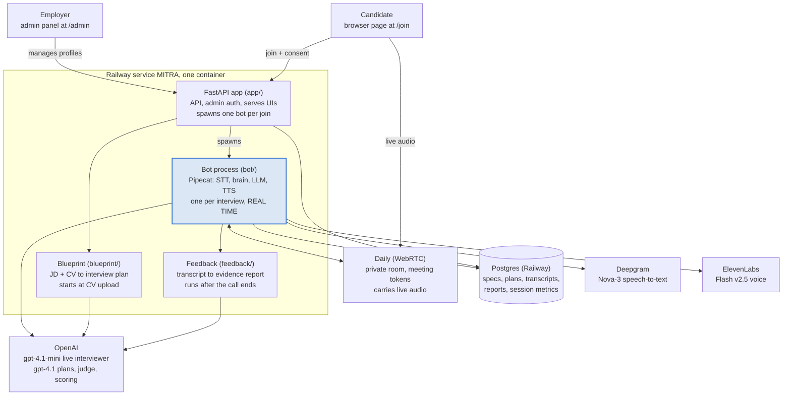

# MITRA Technical Specification

> **Describes `main` at commit `3aa8dac`, as of 2026-11-13.** Keep this file in
> step with the code: when a change alters anything below, update the section in
> the same commit. The measurements behind the numbers here live in
> [DECISIONS.md](DECISIONS.md).

| | |
| --- | --- |
| [1. Overview](#1-overview) | what MITRA is, users, scope |
| [2. System architecture](#2-system-architecture) | the four subsystems and the diagnostic map |
| [3. Tech stack and third-party services](#3-tech-stack-and-third-party-services) | vendors, models, libraries |
| [4. End-to-end interview flow](#4-end-to-end-interview-flow) | JD upload to report |
| [5. Voice pipeline and turn-taking](#5-voice-pipeline-and-turn-taking) | Pipecat, STT, endpointing, silence, ending |
| [6. Interview brain](#6-interview-brain) | the state machine and its invariants |
| [7. Blueprint and feedback pipelines](#7-blueprint-and-feedback-pipelines) | planning before, scoring after |
| [8. Data contracts and persistence](#8-data-contracts-and-persistence) | Pydantic shapes, tables, migrations |
| [9. API surface and security](#9-api-surface-and-security) | routes, auth, consent, capacity |
| [10. Deployment and operations](#10-deployment-and-operations) | Railway, env vars, rules |
| [11. Key decisions and measurements](#11-key-decisions-and-measurements) | what not to quietly undo |
| [12. Known gaps and risks](#12-known-gaps-and-risks) | open items |

---

## 1. Overview

MITRA (Machine Interviewer for Talent Review & Assessment) is a voice AI
interviewer, deployed on Railway and working end to end. The bot introduces
itself to candidates as Mitra. It is a proof of concept: a working flow first,
with the data contracts kept clean because they are the long-term IP.

**What it does**

1. An employer uploads a job description (JD) and settles what the interview
   should evaluate in a chat with an AI. The result is an `EvaluationSpec`.
2. The employer uploads a CV. A plan for that specific candidate
   (`InterviewBlueprint`) is generated in the background.
3. The candidate joins a branded web page with a meeting ID and password,
   accepts a consent notice, and is interviewed by voice for the configured
   length (20 to 90 minutes, default 40).
4. The transcript is scored into a `FeedbackReport`: per-competency scores, each
   backed by verified quotes from the transcript.

**A human makes every decision.** The report describes how strong the evidence
is. Nothing in the system accepts or rejects anyone.

**Users**

| User | Access | Does |
| --- | --- | --- |
| Employer (single admin) | `/admin`, one shared password | Creates profiles, runs the clarification chat, uploads CVs, starts interviews, reads reports |
| Candidate | `/join`, meeting ID + password | Gives consent, takes the voice interview |

**Out of scope for the POC:** Google Meet, Zoom or Teams integration; proctoring
or video analysis; detecting scripted or AI-assisted answers; OpenAI Realtime
speech-to-speech; ATS integrations; multi-tenant accounts and billing; automatic
hiring decisions; languages other than English.

---

## 2. System architecture

MITRA is four separable Python packages in one Railway container, and only the
bot runs in real time.



The bot is one OS process per interview, spawned by FastAPI when the candidate
joins, and it exits after saving the transcript. Blueprint generation runs when
the CV is uploaded and scoring runs after the call, both on `gpt-4.1`. FastAPI
and the bot both write to Postgres, and the bot starts scoring once its
transcript is committed. `shared/contracts.py` holds the Pydantic shapes every
package imports.

**Which layer owns which symptom.** Name the layer before changing anything;
these feel alike and live in different files.

| Symptom | Layer | Look at |
| --- | --- | --- |
| Wrong words in the transcript | STT | `bot/services/stt.py` |
| Cuts the candidate off mid-thought | Endpointing | `bot/turn_taking.py` |
| Long pause before replying | STT finalisation, then endpointing | `stt_lag`, then `endpointing_median_ms` |
| Asks a poor question | Brain or blueprint | `bot/brain/prompting.py`, `blueprint/generate.py` |
| Repeats itself, ignores an answer | Brain state | `bot/brain/brain.py` |
| Does not hang up | Ending chain | `bot/ending.py`, brain `is_finished` |
| Report reads unfairly | Conversation health, then scorer | `feedback/` |

---

## 3. Tech stack and third-party services

Five paid vendors carry the product; everything else is open-source Python and
plain browser JavaScript. Each vendor sits behind one adapter file so it can be
swapped in one place.

**Third-party services**

| Service | Role | Model / product | Adapter |
| --- | --- | --- | --- |
| OpenAI | Live interviewer | `gpt-4.1-mini` (`OPENAI_LLM_MODEL`) | `bot/services/llm.py` |
| OpenAI | Off-path judge: depth, claims, contradictions | `gpt-4.1` | `bot/brain/drivers.py` |
| OpenAI | Clarification chat, blueprint generation, plan refinement | `gpt-4.1` (`OPENAI_BLUEPRINT_MODEL`) | `blueprint/` |
| OpenAI | Feedback scoring | `gpt-4.1` (`OPENAI_FEEDBACK_MODEL`) | `feedback/score.py` |
| Deepgram | Speech-to-text, active in production | Nova-3, streaming | `bot/services/stt.py` |
| OpenAI | Speech-to-text fallback, used only when `DEEPGRAM_API_KEY` is absent | `gpt-realtime-whisper` | `bot/services/stt.py` |
| ElevenLabs | Interviewer voice | `eleven_flash_v2_5`, one voice ID | `bot/services/tts.py` |
| Daily | WebRTC audio rooms: private rooms, meeting tokens, bot and candidate join as participants | REST API, `daily-python` via Pipecat, `daily-js` in the browser | `bot/services/daily.py` |
| Railway | Hosting: one Docker service plus Postgres, US region | 1 replica | `railway.json`, `backend/Dockerfile` |
| GitHub | Source hosting | `prateekverma547/MITRA` | |

**Model tiering is policy.** Three roles, each configurable, never collapsed
into one. A reasoning model never goes on the live conversation path, because
its thinking time is silence the candidate hears.

**Backend** (Python 3.12, managed with uv)

- **Pipecat 1.6.0**: the voice pipeline framework, with the daily, openai,
  elevenlabs, silero and deepgram extras. Python 3.12 is required because
  Pipecat 1.6.0 still imports `audioop`, which 3.13 removed.
- **Silero VAD**: detects when someone is speaking.
- **Smart-turn v3**: decides when the candidate has finished. A bundled ONNX
  model on onnxruntime; torch is deliberately not installed.
- **FastAPI + Uvicorn**: the API, which also serves both frontends.
- **SQLAlchemy 2 (async)**: asyncpg for Postgres in production, aiosqlite for
  local SQLite.
- **Pydantic v2**: the data contracts.
- **pypdf, python-docx**: text extraction from uploaded JDs and CVs.
- **openai SDK**: off-path model calls.
- **loguru, python-dotenv, aiohttp, tzdata**: logging, config, HTTP, timezone
  data inside the container.
- **pytest, pytest-asyncio**: tests.

**Frontend**

- Plain HTML and vanilla JavaScript, no framework and no build step.
- Admin panel: `frontend/admin/index.html` + `admin.js`, hash routing.
- Candidate page: one file, `frontend/candidate/index.html`, covering join,
  consent, the call and the thank-you screen.
- `daily-js` from the unpkg CDN in headless call-object mode, so the UI is ours
  and Daily's branding never shows.
- React + Vite + TypeScript is the stated target once the panel settles. Not
  built.

**Infrastructure**

- Docker image on `python:3.12-slim` with ffmpeg and libsndfile.
- Async jobs: FastAPI `BackgroundTasks` plus a status column. No queue, Redis or
  Celery.
- One OS subprocess per interview, spawned by FastAPI when the candidate joins.

---

## 4. End-to-end interview flow

Work is scheduled the moment its input arrives, never when its output is needed:
the blueprint starts at CV upload and scoring starts when the transcript is
saved.

| # | Step | Route / trigger | What happens |
| --- | --- | --- | --- |
| 1 | Create profile | `POST /jobs` | JD uploaded (PDF, DOCX, TXT, MD; 10 MB max), text extracted, employer-typed `title` and `business_unit` stored. Clarification chat begins. |
| 2 | Clarify | `POST /jobs/{id}/clarify` (repeated) | Multi-turn chat fills the `EvaluationSpec`: competencies and weights, seniority, red flags, duration. Anything the model assumed is listed as `inferred` and flagged. Employer confirms; spec locks. |
| 3 | Upload CV | `POST /jobs/{id}/candidates` | CV text stored; blueprint generation starts as a BackgroundTask. Status column moves to `ready` or `failed`. |
| 4 | Refine (optional) | `POST /candidates/{id}/refine` | Employer describes a change in words; the plan is regenerated with it. Hand-refined plans are protected from later spec revisions. |
| 5 | Book | `POST /candidates/{id}/interviews` | Private Daily room (24 h expiry), human-readable meeting ID and password. One live session per candidate. |
| 6 | Join | `POST /interviews/join` (public) | Credentials checked, consent required and timestamped, capacity checked, 90-minute Daily token minted, **bot process spawned now**. Browser timezone recorded. |
| 7 | Interview | Bot process | Spoken greeting, then the brain walks opening, competencies, closing. Call ends after the goodbye. |
| 8 | Persist | Bot shutdown path | Transcript, section outcomes and session metrics written to Postgres; status `completed`. |
| 9 | Score | Background, after the transcript commit | `FeedbackReport` generated and stored. `POST /interviews/{id}/feedback` retries if the process died mid-scoring. |
| 10 | Review | `GET /interviews/{id}` | Panel shows scores and evidence first, written summary last. |

**Spec revisions never reach backwards.** `POST /jobs/{id}/reopen` reopens a
locked spec and `spec_version` increments on confirmation. Already-interviewed
candidates are never touched, hand-refined plans are flagged stale, and everyone
else is regenerated in the background.

---

## 5. Voice pipeline and turn-taking

Every stage streams, so the first LLM token reaches the voice before the reply
is finished. Tuning priority is fixed: **(1) never interrupt the candidate,
(2) feel fast.** The first is never traded for the second.

**Pipeline** (`bot/run_bot.py`)

```
Daily in -> STT -> user aggregator -> BrainDirector -> LLM -> TTS -> Daily out -> assistant aggregator
```

- `BrainDirector` rewrites the LLM context and system instruction each turn,
  then lets the frame through. It never waits for or intercepts the reply.
- Observers (latency, transcript, silence ladder, session ender) watch every
  frame wherever it is. Anything reacting to output-transport frames must be an
  observer, not a processor.

**When has the candidate finished?** (`bot/turn_taking.py`) Three stacked layers:

| Layer | Setting | Job |
| --- | --- | --- |
| Silero VAD | `VAD_STOP_SECS = 0.2`, `VAD_START_SECS = 0.2` | Detects a silence gap. Does not end the turn. |
| Smart-turn v3 | `TURN_END_CONFIDENCE = 0.8` | Judges from prosody whether the sentence sounded finished. Pipecat's built-in bar is 0.5; ours requires 0.8. |
| Hard cap | `SMART_TURN_STOP_SECS = 4.0` | Ends the turn anyway if the model stays unsure. Above 3.0 so a 3-second thinking pause is never cut off. |

Neither STT vendor does its own endpointing (`endpointing=False` on Deepgram,
`turn_detection=False` on OpenAI), so they cannot undo the pause tolerance.

**STT finalisation.** Deepgram confirms when a transcript is final; OpenAI's
service never does, so every OpenAI turn waits out a fixed timer. Deepgram's
wait is 0.35 s against a measured maximum of 0.31 s and must not be lowered.

**Greeting.** The first line is assembled in Python and sent straight to TTS,
with no model call. It uses the candidate's browser timezone for good morning,
afternoon or evening (plain hello outside 05:00 to 22:00), names the bot as an
AI, and waits `GREETING_SETTLE_SECONDS = 1.0` so the first word is not lost
before the browser subscribes to audio.

**Silence ladder** (`bot/silence.py`). Measures dead air after the bot stops
speaking and before the candidate starts; it never runs during a mid-answer
pause.

| Rung | At (default) | Action |
| --- | --- | --- |
| 1 | 20 s | Spoken nudge: "Take your time, there's no rush." Scaled by question difficulty: 0.75x in opening and closing, 1.6x when probing a competency. |
| 2 | 40 s | Rephrase the question and suggest checking the microphone. |
| 3 | 120 s | Close the session gracefully. |

**Presence** (`bot/presence.py`). Daily join and leave events stop the ladder
nudging an empty room, and a dropped call is recorded as a connection problem,
not as candidate silence.

**Ending** (`bot/ending.py`). An observer ends the call on `BotStoppedSpeaking`
once the brain reports the interview finished, so the goodbye is heard first.
The silence ladder is the backstop if that path fails.

---

## 6. Interview brain

The brain (`bot/brain/`) is a context planner and state machine, not a text
generator: it decides what the model sees and when to move on, and the
streaming pipeline writes the words. It is pure and synchronous, never awaits,
and never imports Pipecat, so the same object runs in the live pipeline and in a
text-only test harness. Full detail in [BRAIN.md](BRAIN.md).

**Interface**

- `plan_turn()` returns the system instruction and messages for the next turn.
- `observe(candidate_text, bot_text)` records what was said and decides
  transitions.
- `pending_judgment_request()` / `apply_judgment()`: off-path LLM work requested
  by the brain and delivered by its driver. If a verdict has not arrived,
  heuristics rule that turn.
- `bot_finished_speaking(said)`: called live so the closing goodbye is observed
  even though nobody replies to it.
- `outcomes()` returns one `SectionOutcome` per section.

**Sections.** `build_sections()` turns a blueprint into
`opening -> competency x N -> closing`, walked in order, never revisited.

| Section | Floor / ceiling turns | Notes |
| --- | --- | --- |
| Opening | 2 / 3 | Staged warm-up: hello, orientation, one light question. No interview questions yet. |
| Competency | 2 / 6 | Depth ramp: broad first question, then one layer deeper, then the hard question. Judge decides inside the band. |
| Closing | at most 2 interviewer turns | A closing turn with a question waits for a reply; one without is a goodbye and ends the interview. |

A turn is an **exchange**, not an utterance: only the first candidate utterance
after an interviewer turn spends a turn, so an answer arriving in fragments is
counted once.

**Small, bounded context.** The model sees only the current section's last 8
turns, plus one bridging exchange at a section boundary. Earlier sections arrive
as up to 12 carried claims extracted by the judge. The prompt stays at roughly
800 to 1,700 tokens for the whole interview, which is what makes a mini-tier
live model viable.

**Time.** Each section has a budget from the blueprint. After an over-run,
remaining competencies are squeezed in proportion to weight against duration
plus grace (default 5 minutes). A section pushed below 50% of its budget is
flagged as a coverage shortfall. At the hard stop the brain skips straight to
the closing.

**Deterministic detectors**

| Module | Detects | Response |
| --- | --- | --- |
| `repair.py` | "Sorry, what?" / "What do you mean?" / echo | Repeat the same question / say it more simply / suggest headphones. Does not spend a turn; two attempts maximum. "I don't know" is an answer. |
| `refusal.py` | Declining a question, whole-utterance match | 1: easier question on the same topic. 2: change topic and offer to stop. 4: close the interview. |
| `withdrawal.py` | Asking to end the interview | Explicit request ends at once; a softer one gets one offer. Corroborates the model's `end_interview` tool call (`bot/tools.py`). |

**Invariants**

1. **Never claim history the model cannot see.** The prompt states plainly when
   the candidate has said nothing substantive yet.
2. **Judgement never blocks a spoken turn.**
3. **Declining is not answering badly.** `declined_turns` is recorded apart from
   coverage, and so is a withdrawal.
4. **Coverage never flatters.** Opening and closing report `insufficient` when
   nothing substantive was said.
5. **Contradictions are recorded always and probed at most once,** neutrally and
   without a verdict.

---

## 7. Blueprint and feedback pipelines

Both run offline on `gpt-4.1`, where latency does not matter, and both check
model output in code rather than trusting it.

**Clarification** (`blueprint/clarify.py`). A multi-turn chat fills the
`EvaluationSpec`. The model must emit an `inferred` list of everything it
assumed but was not told, mark those items inline in the summary, and the panel
surfaces them. This is structural because a prompt rule alone let the assistant
write an employer's dodged answer back to them as their stated position.

**Blueprint generation** (`blueprint/generate.py`)

- Input: the spec, the CV text and the JD text.
- Output: candidate summary, CV claims to verify, per-competency seed questions
  written against this CV (easiest to hardest, one question each), target
  depth, interviewing guidance, and a suggested opening.
- **Time budgets are computed in code.** The model gives a relative `emphasis`
  per competency (0.5 to 2.0); minutes = `weight x emphasis`, normalised to the
  duration minus 2 minutes of opening and 2 of closing, with a 3-minute floor
  per competency, rounded to half minutes. The contract validator rejects any
  blueprint that overruns the duration.
- **Domain vocabulary is verified.** Up to 12 terms, each kept only if found in
  the JD or CV (trailing-s tolerance only). Anything invented is discarded.
- **Refinement** (`blueprint/refine.py`) regenerates a plan from an employer's
  written instruction.

**Feedback scoring** (`feedback/`)

- Runs once, after the transcript is committed, against the complete
  transcript. Never on the live path, never between turns. A scoring failure
  cannot take the transcript down with it.
- Scored against the spec snapshot inside the candidate's own blueprint, not the
  profile's current spec.
- **Every quote is verified in code** (`feedback/score.py`): matched on
  lowercase alphanumerics against candidate turns only. Found at another turn:
  re-anchored. Found nowhere: dropped. A score left with no evidence is
  downgraded to insufficient signal. A red flag with no surviving evidence is
  dropped.
- **Recommendation is capped by weighted coverage:** a confident signal needs at
  least 75% of the spec by employer weight assessed; otherwise it is capped at
  `limited_evidence`.
- **Conversation health** (`feedback/health.py`) is derived from the transcript:
  repair requests, echo, prompted silences, disconnects. A degraded channel is
  stated at the top of the report and caps the recommendation, so a bad
  connection is not read as a weak candidate.
- Report layout: scores and evidence first, written summary last.

**Recommendation signals:** `strong_evidence_for`, `some_evidence_for`, `mixed`,
`limited_evidence`, `insufficient_signal`. They describe the strength of
evidence gathered, never whether to hire.

---

## 8. Data contracts and persistence

`backend/shared/contracts.py` is the single source of truth for every shape
crossing a package boundary; nothing redefines them locally. Each contract
carries `schema_version` (currently 1). When the brain and the generator
disagree on a shape, the brain wins, because the consumer defines it.

**Contracts**

| Contract | Produced by | Key fields |
| --- | --- | --- |
| `EvaluationSpec` | Clarification chat | role title, seniority, experience, competencies (id, name, description, weight), red flags, `duration_minutes` (20 to 90, default 40), `overrun_grace_minutes` (0 to 15, default 5), tone |
| `InterviewBlueprint` | Blueprint generation | embedded spec snapshot, candidate name and summary, claims to verify, `competency_plans` (target depth, seed questions, minutes), opening and closing minutes, guidance, `domain_language` |
| `SectionOutcome` | Brain, per section | coverage level, key claims anchored to turns, contradictions, turns and seconds spent, budget, shortfall flag and reason, `declined_turns` |
| `Transcript` / `TranscriptTurn` | Bot | speaker, text, seconds from start, section id. The auditable ground truth, persisted in full. |
| `FeedbackReport` | Scorer | per-competency score (0 to 5 or null) with verified `EvidenceQuote`s, observed red flags, contradictions, coverage gaps, `ConversationHealth`, summary, recommendation signal |

Validators enforce the rules in the type: a blueprint cannot overrun its
duration or miss a competency, and a score cannot exist without evidence.

**Database tables** (`app/db.py`, SQLAlchemy)

| Table | Holds |
| --- | --- |
| `jobs` | Profile: title, business unit, JD text, `evaluation_spec` (JSON), spec status, `spec_version` |
| `clarification_turns` | The clarification chat, one row per turn |
| `candidates` | CV text, `blueprint` (JSON), blueprint status and error, refinements, `spec_version` built from |
| `interviews` | Meeting ID, password, Daily room, status, timestamps, candidate timezone, `consent_accepted_at`, `transcript`, `section_outcomes`, `session_metrics`, `feedback_report` and its status (all JSON) |

Deleting a profile cascades to its CVs, plans, interviews and transcripts.

**Migrations are additive only.** `create_all` makes missing tables;
`_add_missing_columns` adds new nullable columns to existing tables and refuses
loudly for a NOT NULL column without a default. Locally, SQLite is used when
`DATABASE_URL` is unset; in deployment a missing `DATABASE_URL` is a hard
startup failure, so data is never written to an ephemeral disk.

**Session files.** Each bot also writes `backend/sessions/<id>.json` with
transcript, latency and brain events. In the container these vanish on
redeploy; the database copy is the record.

---

## 9. API surface and security

Every route is behind the admin password except the candidate's join and the
pages needed to reach a login. A test
(`test_every_route_is_guarded_unless_it_is_deliberately_public`) sweeps the
route table, so a new unguarded endpoint fails CI.

**Admin routes** (cookie session)

| Area | Routes |
| --- | --- |
| Profiles | `POST /jobs`, `GET /jobs`, `GET /jobs/{id}`, `DELETE /jobs/{id}`, `POST /jobs/{id}/clarify`, `POST /jobs/{id}/reopen` |
| Candidates | `POST /jobs/{id}/candidates`, `GET /jobs/{id}/candidates`, `GET /candidates/{id}`, `POST /candidates/{id}/refine` |
| Interviews | `POST /candidates/{id}/interviews`, `GET /candidates/{id}/interviews`, `GET /interviews/{id}`, `POST /interviews/{id}/feedback`, `DELETE /interviews/{id}` |

**Public routes:** `POST /interviews/join`, `GET /join`, `GET /health`, the
admin login page and script (`/admin`, `/admin/admin.js`), `/admin/login`,
`/admin/logout`, `/admin/session`, and brand assets.

**Admin auth** (`app/auth.py`). One shared `ADMIN_PASSWORD` with no default,
because a known password on a public URL is worse than no panel. Login issues a
stateless HMAC-SHA256 signed cookie (`mitra_admin`) valid for 12 hours. The
signing key is derived from the password, so changing the password logs everyone
out. Password checks are constant-time. Single admin, no multi-tenancy, by
design.

**Candidate access**

- Daily rooms are private. Candidates never see a Daily URL; they exchange a
  meeting ID and password for a 90-minute meeting token minted by the backend. A
  leaked room link is not enough to enter.
- Wrong ID and wrong password return the same error, so valid meeting IDs cannot
  be probed.
- `JoinResponse` contains nothing about the spec, blueprint or scoring.
- Meeting passwords are stored as written (the employer must read them back to
  the candidate) and never logged.

**Consent.** Shown before joining and blocking: the interview is run by an AI,
it is voice only, it is recorded and transcribed, and the result is shared with
the employer. Explicit checkbox, nothing pre-ticked. The join route rejects
requests without consent, and the acceptance time is stored on the interview. No
bot starts without it. (See section 12: no audio is actually recorded.)

**Capacity** (`app/capacity.py`). `MAX_CONCURRENT_INTERVIEWS` (default 6) is
counted from live child processes, never from interview rows. At the cap a new
join is refused with a retry message before consent or a token is taken. A
candidate reconnecting to their running bot is never refused. Refusing one
candidate costs a reschedule; an out-of-memory restart ends every interview on
the container.

**Personal data.** JDs, CVs, transcripts and reports about named people live in
Postgres. `cv/`, `jds/`, `uploads/`, `*.db` and `backend/sessions/` are
gitignored and excluded from the Docker image.

---

## 10. Deployment and operations

Production runs on Railway (project MITRA, environment `production`) at
<https://mitra-production-a78c.up.railway.app>. On 2026-11-13 the live build was
commit `3aa8dac`. Day-to-day running is in [OPERATIONS.md](OPERATIONS.md).

**Topology**

| Resource | Detail |
| --- | --- |
| Service `MITRA` | One container: Uvicorn serves the API and both UIs, and spawns `python -m bot.run_bot` per interview |
| Postgres | Railway add-on with a persistent volume, linked via `DATABASE_URL = ${{Postgres.DATABASE_URL}}` |
| Replicas | 1, pinned. A bot is a child of one container; more replicas let a rebalance orphan a live interview |
| Health check | `GET /health`, 300 s timeout. Proves the API booted, says nothing about the bot |
| Restart | On failure, 3 retries |

**Image** (`backend/Dockerfile`). Build context is the repo root.
`python:3.12-slim` plus ffmpeg and libsndfile, dependencies installed with
`uv sync --frozen` from the lockfile, layout mirrored as `/app/backend` and
`/app/frontend`, `STOPSIGNAL SIGINT`. About 2.5 GB; the `local-smart-turn` extra
is excluded because it would add about 570 MB of torch that is never loaded.

**Environment variables**

| Variable | Required | Notes |
| --- | --- | --- |
| `OPENAI_API_KEY` | yes | Live model, judge, blueprint, feedback, STT fallback |
| `ELEVENLABS_API_KEY`, `ELEVENLABS_VOICE_ID` | yes | Voice verified at bot startup, before joining the room |
| `DAILY_API_KEY` | yes | Rooms and tokens |
| `DATABASE_URL` | yes in deployment | Missing = hard startup failure |
| `ADMIN_PASSWORD` | yes | No default |
| `DEEPGRAM_API_KEY` | optional | Present = Deepgram STT, absent = OpenAI. Deleting it is the fastest rollback, no deploy needed |
| `MAX_CONCURRENT_INTERVIEWS` | optional | Default 6 |
| `DEFAULT_TIMEZONE` | optional | Greeting fallback, default `Asia/Kolkata` |
| `OPENAI_LLM_MODEL`, `OPENAI_BLUEPRINT_MODEL`, `OPENAI_FEEDBACK_MODEL` | optional | Defaults `gpt-4.1-mini`, `gpt-4.1`, `gpt-4.1`; not set in production |
| `APP_BASE_URL` | optional | Base URL for links |

**Operational rules**

1. **Never deploy during a live interview.** A redeploy kills every bot
   mid-sentence; there is no graceful drain. Check the panel for anything in
   progress, or the logs for `bot spawned`, first.
2. **No app sleeping or scale-to-zero.** A 40-minute interview has long quiet
   stretches.
3. **Raise the concurrency cap from measured CPU**, not from memory arithmetic.
   Memory allows about 19 bots on the 8 GB replica; per-bot CPU has not been
   measured.
4. **Verify bot changes with a real call.** A green health check proves nothing
   about the bot.

**After any deploy:** `/health` returns `{"status":"ok"}`, `GET /jobs` without a
cookie returns 401, `GET /join` returns 200.

**Reading a session.** Each interview records `ttfa_median_ms` (end of
candidate speech to first bot audio), `endpointing_median_ms`,
`stt_lag_median_s`, `tolerated_pauses_s`, `turn_end_probabilities`,
`false_turn_end_rate`, `stt_provider`, plus brain and silence events. Healthy on
Deepgram: TTFA about 1,700 ms, endpointing about 380 ms, STT lag about 0.27 s. A
single TTFA above 5 s with several tolerated pauses is usually the system
correctly waiting for a halting speaker.

**Testing.** `uv run pytest tests/ -q` runs the deterministic suite (479 tests,
about 10 s, no keys, fake LLM). `RUN_BEHAVIOR_TESTS=1` runs the real-model
behaviour suite separately. Scripts in `backend/scripts/` hold real scripted
conversations (withdrawal, unheard candidate, model comparison, contradiction
rate) and must be run after any change to interview behaviour.

---

## 11. Key decisions and measurements

Most constants in this codebase were measured, and [DECISIONS.md](DECISIONS.md)
holds the evidence. Before changing one, re-run its measurement rather than
argue with it.

| Decision | Evidence | Would change it |
| --- | --- | --- |
| Self-hosted Pipecat, not a managed voice agent (Vapi, OpenAI Realtime, Deepgram Voice Agent) | Turn-taking must stay tunable and observable; Deepgram Voice Agent is $4.50/hour ($3.00 per 40-minute interview) against well under $1 assembled | An orchestrator exposing tunable endpointing and frame-level telemetry |
| Deepgram replaces OpenAI for STT | Rule set in advance: median STT lag of about 1 s triggers a trial. Measured 1.04 s. Deepgram: STT lag 0.27 s (-74%), endpointing 378 ms vs 1,483 ms, TTFA 1,694 ms vs 2,430 ms, about 72% cheaper | Truncated transcripts. Raise the 0.35 s wait first |
| `SMART_TURN_STOP_SECS = 4.0` | Pipecat's 3.0 s collides with the requirement never to cut off a 3-second pause. Largest remaining latency source, accepted deliberately | A listening session, never a tuning tweak |
| Smart-turn confidence 0.8, turns counted per exchange | Live session `int_0a7ca5d0aca5`: a 40-minute interview reached its closing in 291 s; 52 candidate fragments for 12 interviewer turns, turn started 74 times | `false_turn_end_rate` from the next real session |
| `gpt-4.1-mini` stays on the live path | Only failure vs `gpt-4.1`: stacking two questions per turn (up to 38%). Fixed in the prompt to 0% on both models | Mini accepting hollow answers or softening redirects: switch to `gpt-4.1`, no debate |
| Prompt structure beats emphasis | Contradiction callback: 0% to 80% to 100% across three phrasings; the stronger model complied less at the middle one | Re-run `scripts/contradiction_rate.py` after any edit |
| Judge precision weighted above recall | 12 labelled cases: precision 0.50 to 1.00, recall 1.00, once exclusions were listed | A false contradiction is a written claim about someone's honesty |
| Withdrawal detected by model tool call plus patterns | Patterns caught 0 of 16 natural phrasings; the model caught 10 of 10 but had 2 false positives in 6. Both agree: end at once; model only: ask once | Re-run `scripts/tool_call_check.py` after editing the tool description |
| Greeting spoken, not generated | Removed a round trip of about 7 s, and the introduction can no longer be skipped | |
| Concurrency cap 6, counted from live processes | Bot about 224 MB idle; one too many OOM-kills every interview on the container | Measured per-bot CPU |
| No em dashes in anything a person reads | Strongest machine-written tell. One report: 3 before the rule, 0 after | |

**Two rules that override everything:** name the layer before touching anything
(wrong words = STT, cutting off = endpointing), and never trade "doesn't
interrupt" for "feels fast".

---

## 12. Known gaps and risks

The two most urgent items are the consent notice, which promises an audio
recording that does not exist, and the Railway config deadline on 2026-12-01.

| Item | State | Impact | Next step |
| --- | --- | --- | --- |
| Consent says "recorded", no audio is recorded | Consent screen says the conversation is recorded and the recording is shared with the employer. Daily cloud recording is never enabled and nothing saves audio; only the transcript is kept | An inaccurate consent notice | Decide: reword to "transcribed", or enable Daily recording with a retention policy |
| `railway.json` deprecated | Railway reads Config as Code only until 2026-12-01. It holds `numReplicas: 1` and the health check | If unread and the dashboard differs, replicas could rise and orphan live interviews | Run `railway config migrate` with no interviews live; confirm replicas = 1 in the dashboard |
| Unpinned external dependencies | `daily-js` from unpkg with no version; `ghcr.io/astral-sh/uv:latest` in the Dockerfile | Candidate page or build can change with no code change | Pin both to exact versions |
| Cost telemetry | Not built (Milestone 3 Definition of Done item) | Every cost figure is arithmetic; only STT is estimated (about $0.19 per 40-minute interview on Deepgram) | Log LLM tokens, TTS characters, STT and call minutes per interview |
| Smart-turn confidence 0.8 | Deployed 2026-11-13, not yet measured | May still split answers, or make turns feel slow | Read `false_turn_end_rate` and `turn_end_probabilities` from the next real session |
| Deepgram trial | Won on one 63-second session | OpenAI path still in the code | Run a full-length interview, then delete the OpenAI STT path |
| Bot evaluates out loud | Observed saying "that's a good approach" | Leaks judgement, biases the next answer | Prompt rule plus a scripted check |
| Echo detection | Counted after the call, not live | Bot can treat its own voice as an answer mid-call | Live detection in the brain |
| Per-bot CPU | Unmeasured | Concurrency cap of 6 is a guess | Measure during concurrent interviews on the Metrics tab |
| Redeploys kill live bots | Accepted for the POC; mitigation is operational | Lost interviews if the rule is broken | Check for live sessions before every deploy |
| Admin panel | Plain JavaScript; React + Vite + TypeScript is the target | Harder to extend | Port once the panel shape settles |
| `EvaluationSpec.language` | Field exists, nothing reads it | English only | Leave until other languages are in scope |
| Stale deploy guide | `DEPLOY.md` says there is no employer UI and omits `ADMIN_PASSWORD` and `DEEPGRAM_API_KEY` | Misleads whoever deploys next | Update it to match [OPERATIONS.md](OPERATIONS.md) |
| Unmerged `stg` branch | 33 commits on `origin/stg` not in `main`, deployed to production twice on 2026-11-13 before `main` was redeployed | This spec does not describe that work | Review `stg`, then merge or retire it and update this file |
